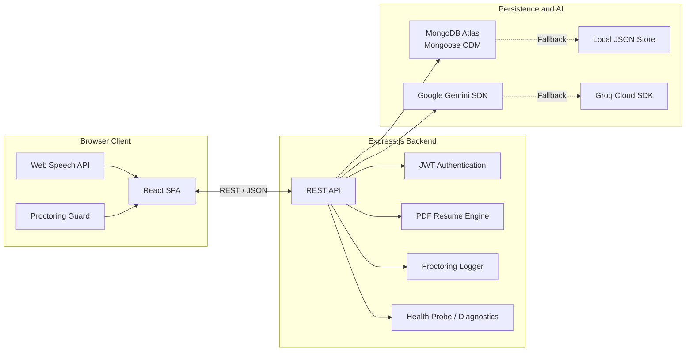

# MockInterviewHub

[](https://github.com/rahulmahasetha/MockInterviewHub/actions/workflows/ci.yml)
[](https://github.com/rahulmahasetha/MockInterviewHub/actions/workflows/cd.yml)
[](https://nodejs.org/)
[](https://react.dev/)
[](https://github.com/rahulmahasetha/MockInterviewHub/actions)
[](LICENSE)

MockInterviewHub is a modern, production-grade, AI-powered career preparation platform designed to help candidates prepare for technical and behavioral interviews. Powered by Generative AI with Google Gemini and Groq LLM fallbacks, MockInterviewHub delivers voice-driven interactive mock interviews, PDF resume ATS scoring, browser-based proctoring, 10 specialized technical quiz tracks, and candidate performance analytics.

---

## Table of Contents

- [Project Overview](#project-overview)
- [Key Features](#key-features)
- [System Architecture](#system-architecture)
- [Technology Stack](#technology-stack)
- [Repository Structure](#repository-structure)
- [Prerequisites](#prerequisites)
- [Installation and Setup](#installation-and-setup)
- [Environment Variables](#environment-variables)
- [Running Locally](#running-locally)
- [API Reference](#api-reference)
- [Automated Testing & CI/CD](#automated-testing--cicd)
- [Production Deployment](#production-deployment)
- [Contributing](#contributing)
- [License](#license)

---

## Project Overview

Securing software engineering and technical roles requires a combination of technical depth, clear verbal communication, structured problem-solving, and an ATS-optimized resume. MockInterviewHub bridges the gap between self-study and actual interview rounds by providing:

1. **Conversational AI Mock Interviews:** Candidates practice answering technical and behavioral questions in either voice or written mode, receiving instant multi-dimensional evaluation.
2. **Resume ATS Scanner & Optimizer:** Candidates upload PDF resumes to extract structured data, evaluate keyword overlap against target job descriptions, identify weak bullet points, and rewrite them using Google's XYZ formula.
3. **Assessment Proctoring:** Pre-interview hardware checks (camera, microphone, fullscreen) and live violation detection (tab-switching, window minimization) simulate authentic remote evaluation conditions.
4. **Structured Subject Area Quizzes:** 10 curated technical tracks covering 100 questions across modern frontend, backend, core systems, DevOps, AI, ML, deep learning, data science, cybersecurity, and algorithms.
5. **Gamification & Learning Streaks:** Daily login rewards, streak milestones, experience points (XP), coin balances, and global competitive leaderboards encourage consistent daily preparation.

---

## Key Features

### Dynamic AI Mock Interviews
- **Role and Difficulty Customization:** Select target roles (Frontend, Backend, Full Stack, DevOps, AI) and difficulty levels (Junior, Mid-Level, Senior).
- **Adaptive Questions:** The AI interviewer evaluates each response in real time and can ask targeted follow-up questions to assess depth of understanding.
- **Dual Mode Input:** Candidates can speak responses aloud using the browser's native Web Speech Recognition API or type written answers.
- **Voice Synthesis:** The AI interviewer reads questions aloud using Web Speech Text-to-Speech (TTS) with natural cadence.
- **Detailed Evaluation:** Each completed session generates scored feedback covering technical depth, communication clarity, confidence, verified strengths, and concrete improvement recommendations.

### Resume ATS Analyzer & Optimizer
- **Server-Side PDF Stream Parsing:** Automatically extracts contact details, skills, experience, education, projects, and certifications from uploaded PDF files (`pdf-parse`).
- **Four-Pillar Compatibility Scoring:** Analyzes resumes across Keyword Match, Formatting & Structure, Quantifiable Impact, and Experience Relevance to produce a 0–100% ATS score.
- **Job Description Matcher:** Paste target job postings to compare keyword overlap, calculate role compatibility, and identify missing industry-standard keywords.
- **Google XYZ Bullet Optimizer:** Converts passive bullet points into high-impact accomplishment statements following the structure: *"Accomplished [X] as measured by [Y], by doing [Z]"* with 1-click clipboard copy.

### Integrity & Proctoring Checks
- **Pre-Flight Hardware Check:** Verifies browser camera access, microphone audio streams, and fullscreen permissions before session entry.
- **Tab & Focus Monitoring:** Tracks tab-switching, window blur, and fullscreen exit events. Automatically alerts the candidate and auto-submits upon reaching the violation limit.

### 10 Curated Technical Quiz Tracks
The platform includes 10 subject area tracks, each featuring interactive 10-level multiple choice quizzes with hints, timers, and coin rewards:
- **Frontend Engineering:** HTML5, Modern CSS3, JavaScript (ES6+), and React.js.
- **Backend Engineering:** Node.js, Express, async I/O, REST design, and microservices.
- **Core Computer Science:** Operating Systems, Computer Networks, and DBMS.
- **DevOps & Cloud:** Docker, Kubernetes, CI/CD pipelines, and cloud infrastructure.
- **Artificial Intelligence:** Search algorithms, heuristic methods, NLP, and knowledge graphs.
- **Machine Learning:** Supervised and unsupervised algorithms, regression, classification, and metrics.
- **Deep Learning:** Neural networks, backpropagation, CNNs, RNNs, and Transformers.
- **Data Science:** Python for data science, Pandas, NumPy, and exploratory data analysis.
- **Cyber Security:** Web application security, OWASP Top 10, network defense, and cryptography.
- **Data Structures & Algorithms:** Arrays, linked lists, trees, graphs, sorting, and dynamic programming.

### Candidate Dashboard & Historical Transcripts
- **Performance Over Time:** Visual SVG charts track score progression across consecutive technical and resume interview sessions.
- **Attempt History:** Comprehensive session history table with full transcripts, category pills, sub-scores, and AI evaluator feedback.
- **Personalized Improvement Plan:** Algorithmic recommendations identify weak topic areas from past attempts and provide direct links to targeted practice modules.

### Resilient Dual-Mode Database
- **Automatic Fallback:** The backend connects to MongoDB Atlas when configured, but automatically falls back to an in-memory/file-based JSON store (`db_fallback.json`) if MongoDB is unreachable, ensuring zero downtime during local development or network outages.

---


## System Architecture

The platform consists of three primary layers:

### 1. Browser Client (React SPA)
- Renders the user interface and handles client-side routing.
- Communicates with the backend through a RESTful JSON API.
- Uses the Web Speech API for voice interactions.
- Supports fullscreen and focus controls for proctoring.

### 2. Express.js Backend API
- Provides authentication, quiz, interview, and resume endpoints.
- Uses JWT middleware for authentication.
- Processes resume PDFs and logs proctoring events.
- Provides health checks and diagnostic endpoints.

### 3. Persistence and AI Engine
- **Database:** MongoDB Atlas with Mongoose.
- **Fallback Storage:** Local JSON store (`db_fallback.json`).
- **Primary AI Provider:** Google Gemini SDK.
- **Fallback AI Provider:** Groq Cloud SDK using Llama models.

## Architecture Diagram





## Data Flow

1. The React client sends requests to the Express.js backend through the REST API.
2. The backend validates requests and applies authentication where required.
3. Application data is stored in MongoDB through Mongoose.
4. Resume processing and proctoring events are handled by the backend.
5. Gemini generates or evaluates interview content, with Groq available as a fallback.
6. The local JSON store provides an alternative persistence mechanism if the primary database is unavailable.

> **Note:** The fallback flows shown above should match the actual implementation. Verify that database fallback and AI-provider failover are implemented before documenting them as automatic mechanisms.

```

The diagram illustrates the direction of data flow: the client talks to the Express API, which in turn persists data and invokes the AI engine for interview generation/evaluation.

---


---

## Technology Stack

| Domain | Technologies & Libraries |
| :--- | :--- |
| **Frontend** | React 18, React Router v6, Axios, React Icons (`react-icons/fi`, `react-icons/fa`), Canvas Confetti, React Toastify |
| **Styling** | Vanilla CSS3 Design System, Responsive Flexbox & Grid layouts, Custom CSS Tokens |
| **Backend** | Node.js (v22 LTS), Express.js, JWT (`jsonwebtoken`), bcryptjs, Multer, CORS |
| **Document Processing** | `pdf-parse` (binary buffer extraction for PDF resumes) |
| **Persistence** | MongoDB Atlas with Mongoose ODM, with automatic fallback to local JSON database |
| **AI / LLMs** | Google Gemini Generative AI SDK, Groq SDK (Llama 3 fallback) |
| **Testing** | Jest, Supertest, React Testing Library, Pytest, Python Requests |
| **CI / CD** | GitHub Actions (Matrix runners on Ubuntu, caching for npm and pip) |
| **Deployment Targets** | **Frontend:** Vercel \| **Backend:** Render / Railway \| **DB:** MongoDB Atlas |

---

## Repository Structure

```text
MockInterviewHub/
|-- .github/
|   `-- workflows/
|       |-- ci.yml                   # CI: linting, 105 backend tests, 97 frontend tests, production build
|       `-- cd.yml                   # CD: deploy hooks, health verification probe, rollback gates
|-- backend/
|   |-- config/
|   |   `-- db.js                    # MongoDB connection manager and index cleanup
|   |-- controllers/                 # Route controllers (auth, quiz, interview, resume, progress)
|   |-- data/
|   |   |-- quizCategoriesData.js    # 10 subject area tracks, 100 questions, structured levels
|   |   `-- quizzesData.js           # Default legacy quizzes data
|   |-- middleware/
|   |   |-- authMiddleware.js        # JWT verification and user authorization
|   |   `-- uploadMiddleware.js      # Multer memory-storage configuration for PDF uploads
|   |-- models/                      # Mongoose schemas (User, Score, QuizCategory, ResumeSection, etc.)
|   |-- routes/                      # Express route endpoints
|   |-- utils/                       # AI caller (Gemini/Groq), PDF parser, DB seeder, helper utilities
|   |-- tests/                       # 105 Jest unit, mock, and API route tests
|   |-- tests_pytest/                # 6 Pytest black-box integration smoke tests
|   |-- requirements.txt             # Python test dependencies
|   |-- server.js                    # Express application entry point and /health probe
|   |-- package.json                 # Backend scripts and dependencies
|   `-- .env.example                 # Backend environment variable template
|-- frontend/
|   |-- public/                      # Static assets, favicon, and index.html
|   |-- src/
|   |   |-- __tests__/               # 97 React Testing Library unit tests
|   |   |-- components/              # UI components (Home, MockInterview, ResumeAI, Dashboard, etc.)
|   |   |-- context/                 # UserProgressContext (state, auth, coins, streaks, XP)
|   |   |-- services/                # Axios HTTP client abstractions
|   |   |-- App.js                   # Application routes and navigation structure
|   |   `-- index.css                # Custom responsive design system stylesheet
|   |-- package.json                 # Frontend dependencies and test runners
|   `-- .env.example                 # Frontend environment variable template
|-- DEPLOYMENT.md                    # Production deployment and secrets guide
|-- README.md                        # Primary project documentation
`-- .gitignore                       # Repository exclusion rules
```

---

## Prerequisites

Before setting up MockInterviewHub locally, ensure you have the following installed:

- **Node.js:** `v20.x` or `v22.x` ([Download Node.js](https://nodejs.org/))
- **npm:** `v10.x` or higher (bundled with Node.js)
- **Git:** ([Download Git](https://git-scm.com/))
- **Python (Optional):** `3.10+` (only needed if running the optional Pytest integration tests)
- **MongoDB (Optional):** Local daemon or free [MongoDB Atlas](https://www.mongodb.com/atlas) URI *(The app operates in local fallback mode if omitted)*

---

## Installation and Setup

### 1. Clone the Repository

```bash
git clone https://github.com/rahulmahasetha/MockInterviewHub.git
cd MockInterviewHub
```

### 2. Configure the Backend

1. Navigate to the `backend` folder:
   ```bash
   cd backend
   ```
2. Copy the environment template:
   ```bash
   cp .env.example .env
   ```
3. Install dependencies:
   ```bash
   npm install
   ```

### 3. Configure the Frontend

1. In a new terminal window, navigate to the `frontend` folder:
   ```bash
   cd frontend
   ```
2. Copy the environment template:
   ```bash
   cp .env.example .env
   ```
3. Install dependencies:
   ```bash
   npm install
   ```

---

## Environment Variables

### Backend Configuration (`backend/.env`)

| Variable | Required | Default / Example | Description |
| :--- | :--- | :--- | :--- |
| `PORT` | No | `3001` | Port on which the Express server listens |
| `NODE_ENV` | No | `development` | Runtime environment (`development`, `production`, `test`) |
| `MONGODB_URI` | No | `mongodb://127.0.0.1:27017/triviatrek` | MongoDB connection URI. Uses local file store if unreachable |
| `JWT_SECRET` | Yes | `your_jwt_secret_key_minimum_32_characters` | Secret key used to sign and verify JWT authentication tokens |
| `GEMINI_API_KEY` | No | *(Empty)* | Google Gemini API key for AI question generation and evaluation |
| `GROQ_API_KEY` | No | *(Empty)* | Groq API key used as fallback LLM if Gemini is unavailable |
| `AI_PROVIDER` | No | `gemini` | Primary AI provider (`gemini` or `groq`) |

### Frontend Configuration (`frontend/.env`)

| Variable | Required | Default / Example | Description |
| :--- | :--- | :--- | :--- |
| `REACT_APP_API_URL` | Yes | `http://localhost:3001` | Full base URL pointing to the backend API server |

---

## Running Locally

### Start Backend Development Server

```bash
cd backend
npm run dev
```
*The server will start at `http://localhost:3001` and verify the database status.*

### Start Frontend Application

```bash
cd frontend
npm start
```
*The React app will launch automatically in your default browser at `http://localhost:3000`.*

---

## API Reference

All requests and responses use standard JSON payloads.

| Method | Endpoint | Access | Description |
| :--- | :--- | :--- | :--- |
| `GET` | `/health` | Public | System uptime, timestamp, and database connectivity probe |
| `POST` | `/auth/signup` | Public | Register a new candidate account with hashed password |
| `POST` | `/auth/login` | Public | Authenticate user credentials and return a signed JWT token |
| `GET` | `/auth/me` | Protected | Fetch profile details of the currently authenticated user |
| `PUT` | `/auth/update-profile`| Protected | Update candidate display name, college, branch, or year |
| `GET` | `/quiz-categories` | Public | Retrieve all 10 subject area tracks and difficulty levels |
| `GET` | `/leaderboard` | Public | Fetch global top scores and user rankings |
| `POST` | `/progress/score` | Protected | Submit completed quiz score and update candidate coins / XP |
| `POST` | `/api/interview/generate-questions` | Public | Generate dynamic interview questions for role and level |
| `POST` | `/api/interview/evaluate-answer` | Public | Evaluate candidate answer transcript and return feedback |
| `POST` | `/api/interview/save` | Protected | Save completed interview session transcript to history |
| `GET` | `/api/interview/history` | Protected | Retrieve all past mock interviews completed by the user |
| `POST` | `/api/resume/upload` | Public | Upload resume (PDF) and receive structured parsed data |
| `POST` | `/api/resume/analyze` | Public | Generate ATS rating, skill gaps, and keyword recommendations |
| `POST` | `/api/resume/log-violation` | Public | Log proctoring warning event (tab switch, window blur) |

---

## Automated Testing & CI/CD

MockInterviewHub features a complete automated test suite across backend and frontend layers with zero reliance on paid external APIs during testing.

### Backend Tests (Jest)
Runs 105 tests covering controllers, auth middleware, health probes, database seeder, and AI fallback logic:
```bash
cd backend
npm test
```
To run tests with coverage reporting:
```bash
npm run test:coverage
```

### Pytest Integration Smoke Tests
Runs 6 end-to-end black-box integration tests verifying live endpoints:
```bash
cd backend
pip install -r requirements.txt
pytest tests_pytest -v
```

### Frontend Tests (React Testing Library)
Runs 97 component tests covering MCQ cards, quiz flows, score summaries, and progress contexts:
```bash
cd frontend
npm test -- --watchAll=false
```
To run tests with coverage reporting:
```bash
npm run test:coverage
```

### Continuous Integration Pipeline
GitHub Actions automatically executes on every push and pull request to the `main` branch:
1. **Backend Job:** Node.js 20 & 22 environment matrix, syntax linting, 105 Jest tests, and Pytest smoke tests.
2. **Frontend Job:** Node.js 20 & 22 environment matrix, 97 component tests, and optimized production build (`npm run build`).

---

## Production Deployment

MockInterviewHub is architected for zero-downtime deployment:
- **Frontend:** Hosted on **Vercel** with automatic edge CDN caching.
- **Backend:** Hosted on **Render** or **Railway** as a managed web service with container auto-scaling.
- **Database:** Hosted on **MongoDB Atlas** with automated connection pooling and schema indexing.

For complete, step-by-step instructions on deployment configuration, environment secrets, and rollback playbooks, consult:

[Production CI/CD & Deployment Guide (DEPLOYMENT.md)](DEPLOYMENT.md)

---

## Contributing

Contributions are welcome and appreciated. To contribute:

1. Fork the repository.
2. Create a descriptive feature branch:
   ```bash
   git checkout -b feature/your-feature-name
   ```
3. Commit your changes:
   ```bash
   git commit -m "feat: add your feature description"
   ```
4. Verify that all automated tests pass:
   ```bash
   cd backend && npm test
   cd ../frontend && npm test -- --watchAll=false
   ```
5. Push to your branch and open a Pull Request against `main`.

---

## License

This project is open-source and licensed under the [MIT License](LICENSE).
