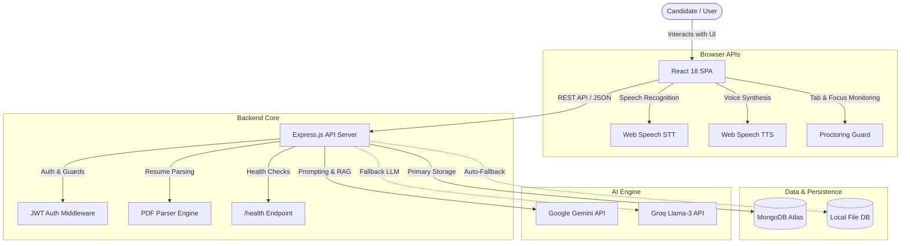
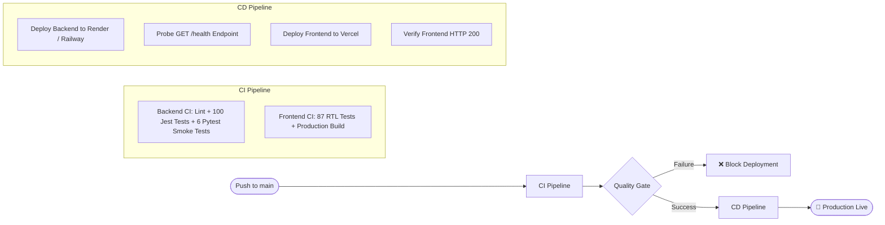

# 🎯 MockInterviewHub

[](https://github.com/rahulmahasetha/MockInterviewHub/actions/workflows/ci.yml)
[](https://github.com/rahulmahasetha/MockInterviewHub/actions/workflows/cd.yml)
[](https://nodejs.org/)
[](https://react.dev/)
[](https://github.com/rahulmahasetha/MockInterviewHub/actions)
[](LICENSE)

**MockInterviewHub** is a production-grade, AI-powered career preparation platform designed to help candidates ace technical and behavioral interviews. By integrating Generative AI (Google Gemini & Groq fallback), the platform offers real-time conversational voice mock interviews, PDF resume ATS evaluation, anti-cheating proctoring, gamified technical quizzes, and candidate performance tracking.

---

## 🌟 Key Features

### 🤖 Dynamic AI Mock Interviews
- **Multi-Track Sessions:** Practice **Technical**, **Behavioral**, or **Resume-Specific** interviews tailored to specific roles and experience levels.
- **Adaptive Questioning:** AI generates contextual follow-ups based on candidate answers, evaluating clarity, technical depth, and problem-solving capability.
- **Instant Comprehensive Feedback:** Evaluates answers across key parameters (technical accuracy, communication, structure) and delivers actionable advice with ideal sample answers.

### 🎙️ Hands-Free Voice Interaction
- **Speech-to-Text (STT):** Speak answers aloud in real time using the browser's native Web Speech API.
- **Text-to-Speech (TTS):** The AI interviewer asks questions audibly with natural speech cadence to recreate an authentic remote interview environment.

### 🛡️ Smart Anti-Cheating Proctoring
- **Real-Time Environment Checks:** Verifies camera and microphone permissions before interview entry.
- **Integrity Tracking:** Detects and logs browser tab switches, window minimization, and fullscreen exits to simulate strict assessment standards.

### 📄 Resume ATS Analyzer & Optimizer
- **Instant PDF Extraction:** Upload your resume to extract contact information, work experience, education, skills, and projects using server-side stream parsing (`pdf-parse`).
- **ATS Match Scoring:** Identifies missing high-impact keywords, computes overall ATS compatibility, and highlights weaknesses.

### 🕹️ Gamified Tech Trivia & MCQ Playground
- **Topic-Based Challenges:** Test your knowledge in Data Structures, Algorithms, JavaScript, React, System Design, and Python.
- **XP, Streaks & Coins:** Unlock higher difficulty tiers as you earn experience and build daily learning streaks.
- **Live Leaderboard:** Real-time competitive leaderboard rankings with persistent user scoring.

### 📊 Candidate Dashboard & Historical Transcripts
- **Past Interview History:** Review every previous interview session, including past audio transcripts, ratings, and time-stamped feedback.
- **Progress Tracking:** Interactive charts showing score improvements over time.

### 🛡️ Resilient Dual-Mode Database
- **Seamless Local Fallback:** Automatically switches to an in-memory / local JSON database (`db_fallback.json`) if MongoDB Atlas is unreachable, ensuring zero downtime during local development or network failures.

---

## 🏗️ System Architecture



---

## 🚀 CI/CD & Deployment Pipeline

MockInterviewHub features an enterprise-grade automated CI/CD pipeline built with **GitHub Actions**:



---

## 📂 Project Structure

```text
MockInterviewHub/
├── .github/
│   └── workflows/
│       ├── ci.yml                 # Automated testing, linting, build & artifact workflow
│       └── cd.yml                 # Continuous deployment trigger & health probe verification
├── backend/
│   ├── config/                    # Database connection & index management
│   ├── controllers/               # Business logic (auth, quiz, interview, resume, progress)
│   ├── middleware/                # JWT verification & request authorization
│   ├── models/                    # Mongoose schemas (User, Score, Quiz, Interview)
│   ├── routes/                    # Express routing endpoints
│   ├── utils/                     # AI caller, resume parser, and database seeder
│   ├── tests/                     # 100 Jest unit, route, and mock tests
│   ├── tests_pytest/              # 6 Pytest black-box integration smoke tests
│   ├── requirements.txt           # Python dependencies for integration tests
│   ├── server.js                  # Main Express app, middleware, and /health probe
│   ├── package.json               # Backend npm scripts and dependencies
│   └── .env.example               # Backend environment variable template
├── frontend/
│   ├── public/                    # Static assets & index.html
│   ├── src/
│   │   ├── __tests__/             # 87 React component & context unit tests
│   │   ├── components/            # UI components (MockInterview, ResumeAI, Dashboard, etc.)
│   │   ├── context/               # AuthContext & UserProgressContext
│   │   ├── services/              # Axios HTTP client & API abstraction
│   │   ├── App.js                 # Routing & application shell
│   │   └── index.css              # Custom responsive stylesheet & Tailwind utilities
│   ├── package.json               # Frontend dependencies and test runners
│   └── .env.example               # Frontend environment variable template
├── DEPLOYMENT.md                  # Comprehensive production deployment & secrets guide
├── README.md                      # Primary project documentation
└── .gitignore                     # Production ignore rules (secrets, coverage, uploads)
```

---

## 🛠️ Tech Stack

| Domain | Technologies & Libraries |
| :--- | :--- |
| **Frontend** | React 18, React Router v6, Axios, React Icons, Canvas Confetti, React Toastify |
| **Styling** | Vanilla CSS3 Design System, Tailwind CSS, Flexbox/Grid Responsive Layouts |
| **Backend** | Node.js (v22 LTS), Express.js, JWT (`jsonwebtoken`), `bcryptjs`, Multer, CORS |
| **Document Processing** | `pdf-parse` (binary buffer PDF extraction) |
| **Database** | MongoDB Atlas, Mongoose ODM, with auto-fallback to local JSON store |
| **AI / LLMs** | Google Gemini Generative AI SDK, Groq SDK (Llama 3 fallback) |
| **Testing** | Jest, Supertest, React Testing Library, Pytest, Python Requests |
| **CI / CD** | GitHub Actions (Matrix runners on Ubuntu, caching for npm and pip) |
| **Hosting (Target)** | **Frontend:** Vercel \| **Backend:** Render / Railway \| **DB:** MongoDB Atlas |

---

## ⚡ Quick Start (Local Setup)

### Prerequisites
- **Node.js:** `v20.x` or `v22.x` ([Download Node.js](https://nodejs.org/))
- **npm:** `v10.x` or `v11.x`
- **Python:** `3.10+` (optional, required only for running Pytest integration tests)
- **MongoDB:** Local MongoDB daemon OR free [MongoDB Atlas](https://www.mongodb.com/atlas) connection URI *(optional: platform runs in resilient fallback mode if absent)*

---

### Step 1: Clone the Repository

```bash
git clone https://github.com/rahulmahasetha/MockInterviewHub.git
cd MockInterviewHub
```

---

### Step 2: Configure & Start the Backend

1. Navigate to the backend directory:
   ```bash
   cd backend
   ```
2. Copy the environment template:
   ```bash
   cp .env.example .env
   ```
3. Update `.env` with your API credentials (or use defaults for offline testing):
   ```ini
   PORT=3001
   NODE_ENV=development
   MONGODB_URI=mongodb://127.0.0.1:27017/triviatrek
   JWT_SECRET=your_jwt_secret_key_minimum_32_characters
   GEMINI_API_KEY=your_gemini_api_key_here
   GROQ_API_KEY=your_groq_api_key_here
   ```
4. Install dependencies:
   ```bash
   npm install
   ```
5. Start the backend development server:
   ```bash
   npm run dev
   ```
   *The backend will be running at `http://localhost:3001`.*

---

### Step 3: Configure & Start the Frontend

1. Open a new terminal and navigate to the frontend directory:
   ```bash
   cd frontend
   ```
2. Copy the environment template:
   ```bash
   cp .env.example .env
   ```
3. Ensure the API URL points to the local backend:
   ```ini
   REACT_APP_API_URL=http://localhost:3001
   ```
4. Install dependencies:
   ```bash
   npm install
   ```
5. Start the React frontend:
   ```bash
   npm start
   ```
   *The application will open automatically at `http://localhost:3000`.*

---

## 🧪 Testing & Quality Assurance

MockInterviewHub maintains a test suite across both frontend and backend layers with zero reliance on paid external APIs during test runs.

### 1. Run Backend Unit & Route Tests (Jest)
Executes 100 unit tests testing controllers, authentication middleware, resume parsing, health probes, and AI fallback handlers:
```bash
cd backend
npm test
```
To run tests with code coverage:
```bash
npm run test:coverage
```

### 2. Run Backend E2E API Integration Tests (Pytest)
Tests live HTTP endpoints, multipart resume uploads, and error handling against a running instance:
```bash
cd backend
pip install -r requirements.txt
pytest tests_pytest -v
```

### 3. Run Frontend Component & Context Tests (React Testing Library)
Executes 87 UI tests across MCQ cards, level markers, score summaries, and progress contexts:
```bash
cd frontend
npm run test:ci
```
To run tests with code coverage:
```bash
npm run test:coverage
```

---

## 📡 API Reference

| Method | Endpoint | Access | Description |
| :--- | :--- | :--- | :--- |
| `GET` | `/health` | Public | System uptime, timestamp, and database connection status probe |
| `POST` | `/auth/signup` | Public | Register a new user account with hashed password |
| `POST` | `/auth/login` | Public | Authenticate user credentials and return JWT token |
| `GET` | `/auth/me` | Protected | Fetch profile details of currently logged-in user |
| `GET` | `/quiz-categories` | Public | Retrieve all available MCQ quiz categories and difficulty levels |
| `GET` | `/leaderboard` | Public | Retrieve global top scores and user rankings |
| `POST` | `/progress/score` | Protected | Submit completed quiz score and update user coins / XP |
| `POST` | `/api/interview/generate-questions` | Public | Generate dynamic interview questions for role and level |
| `POST` | `/api/interview/evaluate-answer` | Public | Evaluate user transcript and return scores and feedback |
| `POST` | `/api/interview/save` | Protected | Save completed interview session transcript to candidate history |
| `GET` | `/api/interview/history` | Protected | Retrieve all historical interviews completed by the user |
| `POST` | `/api/resume/upload` | Public | Upload resume (PDF) and receive parsed structured JSON |
| `POST` | `/api/resume/analyze` | Public | Generate ATS rating, skill gaps, and keyword recommendations |

---

## 🚢 Production Deployment

For complete, step-by-step instructions on deploying MockInterviewHub to **Vercel** (Frontend), **Render / Railway** (Backend), and **MongoDB Atlas**, please consult the detailed guide:

📖 **[Full Deployment & Secrets Guide (DEPLOYMENT.md)](DEPLOYMENT.md)**

---

## 🤝 Contributing

Contributions are welcome! Please follow these steps:
1. Fork the repository.
2. Create your feature branch (`git checkout -b feature/amazing-feature`).
3. Commit your changes (`git commit -m "feat: add amazing feature"`).
4. Verify all tests pass (`npm test` in backend and frontend).
5. Push to the branch (`git push origin feature/amazing-feature`).
6. Open a Pull Request against `main`.

---

## 📄 License

This project is licensed under the **MIT License** — see the [LICENSE](LICENSE) file for details.
