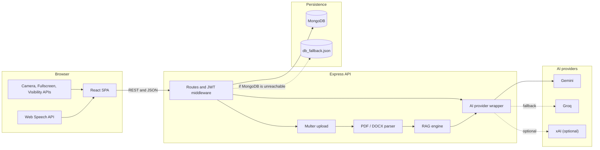
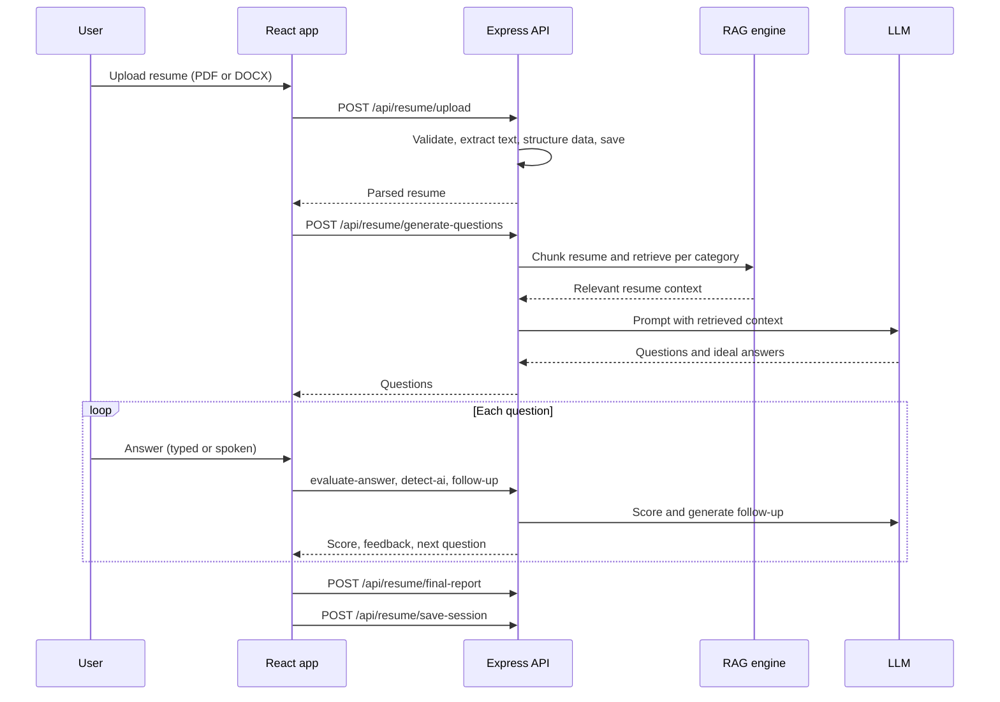

# MockInterviewHub

[](https://github.com/rahulmahasetha/MockInterviewHub/actions/workflows/ci.yml)
[](https://github.com/rahulmahasetha/MockInterviewHub/actions/workflows/cd.yml)
[](https://nodejs.org/)
[](https://react.dev/)
[](https://github.com/rahulmahasetha/MockInterviewHub/actions)
[](LICENSE)

MockInterviewHub is a modern, production-grade, AI-powered career preparation platform designed to help candidates prepare for technical and behavioral interviews. Powered by Generative AI with Google Gemini and Groq LLM fallbacks, MockInterviewHub delivers voice-driven interactive mock interviews, PDF resume ATS scoring, browser-based proctoring, 10 specialized technical quiz tracks, and candidate performance analytics.

---

## Table of Contents

- [The Problem](#the-problem)
- [What It Does](#what-it-does)
- [Features](#features)
- [Tech Stack](#tech-stack)
- [Architecture](#architecture)
- [Project Structure](#project-structure)
- [Getting Started](#getting-started)
- [Environment Variables](#environment-variables)
- [Usage](#usage)
- [API Reference](#api-reference)
- [Testing and CI/CD](#testing-and-cicd)
- [Challenges and Design Decisions](#challenges-and-design-decisions)
- [Known Limitations](#known-limitations)
- [Troubleshooting](#troubleshooting)
- [Deployment](#deployment)
- [Contributing](#contributing)
- [License](#license)

---

## The Problem

Most interview prep is either generic question lists or paid platforms. Generic lists don't reflect your own projects, so you rehearse answers to questions nobody will ask. Real interviews also include pressure that practising alone lacks: a timer, someone watching, and follow-up questions you didn't plan for.

## What It Does

MockInterviewHub puts several preparation tools in one place:

1. **Resume-based interview.** Questions come from your own resume (skills, projects, experience, education, certifications), with follow-ups based on your answers.
2. **Technical mock interview.** Pick a topic (React, Node.js, Java, and others), answer by typing or by speaking, and get per-question scoring.
3. **ATS check.** See keyword matches and gaps against a job description, plus suggested rewrites for weak resume bullets.
4. **Quizzes.** 36 timed multiple-choice quizzes grouped into 10 tracks.
5. **Progress.** Coins, daily streaks, a leaderboard, and a history of past interview attempts.

---

## Features

### Resume-based interview (`/resume-interview`)
- Upload a **PDF or DOCX** resume (up to 10 MB). Files are validated by extension and file signature, parsed on the server, and deleted from disk after processing.
- Structured data (skills, projects, experience, education, certifications) is extracted by an LLM when an API key is configured. Otherwise a rule-based parser handles it.
- **Retrieval-augmented question generation:** the resume is split into chunks and the most relevant ones are retrieved for each category you pick (Skills, Experience, Projects, Education, Certifications). Retrieval uses Gemini embeddings with cosine similarity, and falls back to a local BM25-style keyword scorer if embeddings aren't available.
- Choose difficulty (Easy, Medium, Hard) and questions per category.
- Each answer is scored out of 10 with feedback. The next follow-up question is generated from your answer.
- The AI interviewer reads questions aloud using the browser's speech synthesis, and you can answer by voice (speech recognition) or typing.
- A final report covers technical, communication, and confidence scores, resume match, strengths, weaknesses, and a hiring recommendation. An answer-originality estimate (AI-likelihood) is also produced per answer. Treat it as a rough signal, since it is itself an LLM judgement.

### ATS analyzer (shown before the resume interview starts)
- Scores the resume from 0 to 100 across four areas: keyword match, formatting and structure, quantifiable impact, and experience relevance.
- Paste a job description to see matched and missing keywords.
- Suggests rewrites of weak bullet points using the "Accomplished [X] as measured by [Y], by doing [Z]" structure, with one-click copy.
- The server enforces a 9-second AI timeout and falls back to a deterministic, rule-based analysis. The UI also shows an instant client-side estimate while the scan runs.

### Technical mock interview (`/interview`)
- Topics: HTML, CSS, JavaScript, React, Node.js, Express, MongoDB, Java, C++, Python, Full Stack.
- Written or speaking mode (speech-to-text through the browser's Web Speech API).
- Each answer is scored from 0 to 10 against an AI-generated ideal answer. The summary screen shows overall, technical, communication, and confidence scores, strengths, and areas to improve. These sub-scores are derived on the client from the overall result, not scored separately by the model.
- Past sessions are saved and can be reviewed.

### Quizzes (`/playground/:category`)
- 36 quizzes in 10 tracks: Frontend, Backend, Core CS, DevOps, AI, Machine Learning, Deep Learning, Data Science, Security, and Programming (DSA, Java, Python, C, C++).
- 10 levels per quiz, 360 questions in total. Each question has a 20-second timer and an optional hint. Levels unlock in order.

### Proctoring
- A pre-check requires camera, microphone, and fullscreen access plus an acknowledgement of the rules.
- During a session, tab switches, window blur, and exiting fullscreen count as violations. **3 violations auto-submit the interview.** In the resume interview, violations are also reported to the backend, which logs them to the server console.
- The camera feed is only shown to the user locally. Nothing is recorded or uploaded, and there is no face detection.

### Accounts, progress, and content
- Sign-up and login with JWT (7-day expiry), profile editing, and a password-change flow.
- Coins for daily login (5), correct quiz answers (1 each), a 7-day streak bonus (25), and interview scores (1 per 10%).
- Global quiz leaderboard, plus your interview attempt history.
- An admin page (`/admin`) for editing quiz categories.

### Works without a database or API keys
- If MongoDB can't be reached, the backend falls back to a local JSON file (`backend/db_fallback.json`) and keeps working. `/health` reports which mode is active.
- With no AI keys, interview endpoints return clearly labelled placeholder data (for example, `(Dummy)` questions and a fixed score), so the UI flow can still be tried end to end.

---

## Tech Stack

| Layer | Technology |
| :--- | :--- |
| Frontend | React 18, React Router 6, Axios, React Toastify, React Icons, Tailwind CSS plus custom CSS |
| Backend | Node.js, Express 4, Mongoose 8, JWT (`jsonwebtoken`), `bcryptjs`, Multer, CORS |
| Document parsing | `pdf-parse` (PDF), `mammoth` (DOCX) |
| AI | Google Gemini (`@google/generative-ai`), Groq (`groq-sdk`), optional xAI over HTTP |
| Retrieval | Gemini `embedding-001` with cosine similarity, plus a local BM25-style fallback |
| Browser APIs | Web Speech (recognition and synthesis), MediaDevices, Fullscreen, Page Visibility |
| Data | MongoDB (Atlas or local), or a local JSON file as fallback |
| Testing | Jest, Supertest, React Testing Library, Pytest |
| CI/CD | GitHub Actions; Vercel (frontend) and Render (backend) deploy hooks |

---

## Architecture



How a resume interview flows through the system:



**AI provider behavior** (taken from `backend/utils/ai.js` and the controllers):

- **Technical interview:** Gemini first (it tries several model names), then Groq (`llama-3.3-70b-versatile`) if Gemini fails or isn't configured. Setting `AI_PROVIDER=xai` with an xAI key makes xAI the first choice. With no keys at all, placeholder data is returned.
- **Resume interview and ATS:** use Gemini (or xAI). The ATS endpoint can also use Groq. When no suitable key is available, or an AI call fails, the API returns deterministic fallback output instead of an error.

---

## Project Structure

```text
MockInterviewHub/
├── .github/workflows/
│   ├── ci.yml                  # Tests and build on push / PR to main
│   └── cd.yml                  # Deploy hooks and health check after CI passes
├── backend/
│   ├── server.js               # App entry point, route mounting, /health
│   ├── config/
│   │   ├── db.js               # MongoDB connection and seeding
│   │   └── multer.js           # Resume upload rules (PDF/DOCX, 10 MB)
│   ├── controllers/            # auth, user, quiz, progress, leaderboard, interview, resume, admin
│   ├── middleware/
│   │   └── authMiddleware.js   # JWT verification
│   ├── models/                 # Mongoose schemas
│   ├── routes/                 # Express routers
│   ├── data/
│   │   └── quizCategoriesData.js   # 36 quizzes x 10 levels
│   ├── utils/
│   │   ├── ai.js               # Gemini / Groq / xAI wrappers, JSON cleanup
│   │   ├── ragEngine.js        # Chunking, embeddings, keyword fallback
│   │   ├── resumeParser.js     # Rule-based parser and ATS fallback
│   │   ├── fileUtils.js        # File validation and text extraction
│   │   ├── dbFallback.js       # JSON-file persistence
│   │   ├── seeder.js           # Seeds MongoDB on first connect
│   │   └── helpers.js
│   ├── tests/                  # Jest tests (105)
│   └── tests_pytest/           # Pytest smoke tests against a running server (6)
├── frontend/
│   ├── src/
│   │   ├── components/         # Home, Dashboard, Playground, MockInterview, ResumeAI,
│   │   │                       # Leaderboard, ProfileSection, AdminPanel, proctoring components, ...
│   │   ├── context/            # UserProgressContext (auth, coins, streaks, progress)
│   │   ├── services/api.js     # Axios client and API wrappers
│   │   ├── __tests__/          # React Testing Library tests (97)
│   │   └── App.js              # Routes
│   └── vercel.json             # SPA rewrite for Vercel
├── DEPLOYMENT.md
└── LICENSE
```

---

## Getting Started

### Prerequisites

- Node.js 20 or newer (CI uses 22) and npm
- Git
- Optional: MongoDB (local or [Atlas](https://www.mongodb.com/atlas)). Without it the app uses the local JSON fallback.
- Optional: a [Gemini](https://aistudio.google.com/) and/or [Groq](https://console.groq.com/) API key for real AI output
- Optional: Python 3.10+ to run the Pytest smoke tests

### 1. Clone

```bash
git clone https://github.com/rahulmahasetha/MockInterviewHub.git
cd MockInterviewHub
```

### 2. Backend

```bash
cd backend
cp .env.example .env
npm install
```

Open `backend/.env` and set at least `JWT_SECRET`. For a quick local run **without MongoDB**, delete the `MONGODB_URI` line or leave it empty (see [Troubleshooting](#troubleshooting)). Then start the server:

```bash
npm run dev      # nodemon, auto-restarts on change
# or
npm start
```

The API runs on `http://localhost:3001`. Check it:

```bash
curl http://localhost:3001/health
```

### 3. Frontend

In a second terminal:

```bash
cd frontend
cp .env.example .env
npm install
npm start
```

The app opens at `http://localhost:3000`.

---

## Environment Variables

### Backend (`backend/.env`)

| Variable | Required | Description |
| :--- | :--- | :--- |
| `PORT` | No | Server port. Default `3001`. |
| `NODE_ENV` | No | `development`, `production`, or `test`. |
| `MONGODB_URI` | No | MongoDB connection string. Default `mongodb://127.0.0.1:27017/triviatrek`. If the connection fails after 5 seconds, the app switches to the JSON fallback. |
| `JWT_SECRET` | **Yes, for any real deployment** | Signing key for tokens. If unset, the code uses a built-in development secret, which is not safe in production. |
| `GEMINI_API_KEY` | No | Enables Gemini generation and embeddings. |
| `GROQ_API_KEY` | No | Enables Groq as a fallback provider. |
| `AI_PROVIDER` | No | Only has an effect when set to `xai` (with `XAI_API_KEY`), which makes xAI the first choice. |
| `XAI_API_KEY`, `XAI_MODEL`, `XAI_API_URL` | No | Optional xAI settings. Model defaults to `grok-2-latest`. |

### Frontend (`frontend/.env`)

| Variable | Required | Description |
| :--- | :--- | :--- |
| `REACT_APP_API_URL` | No | Backend base URL. Default `http://127.0.0.1:3001`. It is baked into the bundle at build time, so never put secrets in it. |

---

## Usage

1. Open `http://localhost:3000` and sign up. The app needs an account for interviews and progress tracking.
2. **Resume interview:** go to *Resume AI Interview*, upload a PDF or DOCX, review the ATS results (optionally paste a job description), then choose difficulty and categories and start.
3. **Technical interview:** go to *Technical Mock Interview*, pick a topic, number of questions, and written or speaking mode.
4. **Quizzes:** open a track from *Courses* or the Subject Areas list and work through the levels.
5. Check your standing and past attempts on the **Leaderboard** page.

Both interview types and the quizzes ask for camera, microphone, and fullscreen access first. Use a Chromium-based browser for speech features, since support for the Web Speech API varies.

### API example

Using the backend directly (the same flow the frontend uses):

```bash
# 1. Create an account and keep the token
TOKEN=$(curl -s -X POST http://localhost:3001/auth/signup \
  -H "Content-Type: application/json" \
  -d '{"username":"demo_user","email":"demo@example.com","password":"secret12"}' \
  | node -pe 'JSON.parse(require("fs").readFileSync(0)).token')

# 2. Generate interview questions
curl -s -X POST http://localhost:3001/api/interview/generate \
  -H "Authorization: Bearer $TOKEN" \
  -H "Content-Type: application/json" \
  -d '{"topic":"React","numQuestions":2}'

# 3. Upload a resume and run an ATS analysis against a job description
curl -s -X POST http://localhost:3001/api/resume/upload \
  -H "Authorization: Bearer $TOKEN" \
  -F "resume=@/path/to/resume.pdf"

curl -s -X POST http://localhost:3001/api/resume/analyze \
  -H "Authorization: Bearer $TOKEN" \
  -H "Content-Type: application/json" \
  -d '{"jobDescription":"React and Node.js developer with Docker and AWS experience"}'
```

With no AI keys configured, step 2 returns placeholder questions:

```json
{
  "success": true,
  "questions": [
    {
      "question": "(Dummy) Can you explain a core concept in React? (Question 1)",
      "idealAnswer": "(Dummy) The ideal answer would explain the core concept in detail."
    }
  ]
}
```

---

## API Reference

The frontend calls the `/api/...` form of the interview, resume, and admin routes. The same routers are also mounted without the `/api` prefix. "JWT" means an `Authorization: Bearer <token>` header is required.

| Method | Endpoint | Auth | Purpose |
| :--- | :--- | :--- | :--- |
| `GET` | `/health` | None | Uptime and database mode (`connected` or `fallback_mode`) |
| `POST` | `/auth/signup`, `/auth/login`, `/auth/forgot-password` | None | Account creation, login, password reset |
| `PUT` | `/auth/update-profile` | JWT | Update profile or password |
| `GET` | `/auth/profile/:userId` | JWT | Current user's profile |
| `GET` | `/quiz-categories`, `/quiz-categories/:slug` | None | List or fetch quizzes |
| `POST` `PUT` `DELETE` | `/quiz-categories[/:slug]` | None | Manage quizzes (used by the admin page) |
| `GET` `POST` `PUT` `DELETE` | `/progress[/:id]` | JWT | Quiz progress, coins, streaks |
| `GET` `POST` `PUT` | `/leaderboard[/:id]` | None | Leaderboard entries |
| `POST` | `/api/interview/generate` | JWT | Generate technical questions for a topic |
| `POST` | `/api/interview/evaluate` | JWT | Score answers |
| `POST` | `/api/interview/save` | JWT | Save a finished session |
| `GET` | `/api/interview/history/:userId` | JWT | Past technical sessions |
| `POST` | `/api/resume/upload` | JWT | Upload and parse a resume (multipart field `resume`) |
| `POST` | `/api/resume/analyze` | JWT | ATS analysis |
| `GET` | `/api/resume/:userId` | JWT | Stored parsed resume |
| `POST` | `/api/resume/generate-questions` | JWT | Resume-grounded questions |
| `POST` | `/api/resume/follow-up` | JWT | Follow-up question |
| `POST` | `/api/resume/evaluate-answer` | JWT | Score one answer |
| `POST` | `/api/resume/detect-ai` | JWT | Answer originality estimate |
| `POST` | `/api/resume/final-report` | JWT | Final interview report |
| `POST` | `/api/resume/save-session` | JWT | Save a finished resume interview |
| `GET` | `/api/resume/history/:userId` | JWT | Past resume interviews |
| `POST` | `/api/resume/proctor-violation` | JWT | Report a proctoring violation |
| `GET` `POST` `PUT` `DELETE` | `/api/admin/sections[/:id]` | JWT | Resume section definitions |
| `GET` `POST` `PUT` `DELETE` | `/users[/:id]` | JWT | User management |

---

## Testing and CI/CD

| Suite | Count | Command |
| :--- | :--- | :--- |
| Backend (Jest and Supertest) | 105 | `cd backend && npm test` |
| Frontend (React Testing Library) | 97 | `cd frontend && npm run test:ci` |
| API smoke tests (Pytest) | 6 | see below |

Tests don't call paid AI APIs. The backend suite runs with empty AI keys.

Coverage reports:

```bash
cd backend && npm run test:coverage
cd frontend && npm run test:coverage
```

The Pytest suite needs a running server:

```bash
cd backend
pip install -r requirements.txt
node server.js &                      # in one terminal, or run in the background
API_BASE_URL=http://127.0.0.1:3001 pytest tests_pytest -v
```

**CI** (`ci.yml`) runs on pushes and pull requests to `main`, on Node 22:
- Backend: clean install, `node --check` syntax validation, Jest with coverage, then the Pytest suite against a live server.
- Frontend: clean install, tests with coverage, production build, and a check that `build/index.html` exists.

**CD** (`cd.yml`) runs after CI succeeds on `main`, or manually. It triggers a Render deploy hook for the backend and deploys the frontend to Vercel, then polls `/health` (up to 15 times, 10 seconds apart) and checks the frontend URL. The steps are skipped with a notice when the matching secrets aren't set. Rollbacks are manual. See [DEPLOYMENT.md](DEPLOYMENT.md).

---

## Challenges and Design Decisions

- **Grounding questions in the resume.** Sending a whole resume to an LLM tends to produce generic questions. Chunking the resume by section and retrieving the most relevant chunks per category keeps questions specific to the candidate's own projects. Embeddings are used when a Gemini key exists, with a local keyword scorer as a no-cost fallback.
- **Keeping the app usable when services fail.** Every AI-backed endpoint has a defined fallback path (another provider, a rule-based parser, or labelled placeholder data), and the backend keeps running on a JSON file if MongoDB is down. That makes the project easy to run and demo, and the tests don't depend on external services.
- **Unreliable LLM output.** Model responses often arrive wrapped in markdown fences or with extra text. `utils/ai.js` strips these and extracts the JSON, and falls back to a default value when parsing still fails, so one bad response doesn't crash a session.
- **Hanging requests.** The ATS endpoint races the AI call against a 9-second timeout, and the UI shows an instant client-side estimate while waiting.
- **Safer uploads.** Resume uploads are restricted by extension and size, checked against the file's actual signature (`%PDF` or the ZIP header for DOCX), mapped to clear error messages for corrupted or encrypted files, and deleted after parsing.
- **Proctoring without a heavy stack.** Pre-checks and violation tracking use only standard browser APIs (MediaDevices, Fullscreen, Page Visibility, window blur), which keeps the feature dependency-free and avoids uploading any video.

---

## Known Limitations

This is a learning and portfolio project, and a few things are worth knowing before treating it as production software:

- **JSON fallback mode is for local development only.** In that mode passwords are stored as plain text. With MongoDB connected, passwords are hashed with bcrypt.
- Quiz write routes (`POST/PUT/DELETE /quiz-categories`) and the leaderboard write routes have no authentication, and there is no admin role check on `/admin`. CORS is open to all origins.
- Password reset checks only the username and email; there is no email verification.
- Proctoring is client-side and can be bypassed by a determined user. It is a practice aid, not an exam-integrity system.
- The Dashboard page includes some placeholder values (for example, the performance chart and some stat cards). Real history is on the Leaderboard and interview pages.
- `/resume-builder` is an unfinished form: it has no save or export, and it loads its sections from a protected endpoint without sending a token.
- The `PreInterviewCheck` rules text says 10 warnings end a session, but the interviews enforce 3.

---

## Troubleshooting

| Problem | Fix |
| :--- | :--- |
| Backend logs "Could not connect to database" and says it is in resilient mode | Expected without MongoDB. The `.env.example` value for `MONGODB_URI` is a placeholder Atlas string. Put in a real URI, point it at a local MongoDB, or remove the line to use the fallback. |
| Frontend loads but requests fail or show network errors | Make sure the backend is running and `REACT_APP_API_URL` matches its address. Restart `npm start` after editing `.env`. |
| `401 Access denied` or "Invalid or expired token" | Log in again. Tokens last 7 days, and changing `JWT_SECRET` invalidates existing tokens. |
| Interview questions start with "(Dummy)" | No AI key is configured. Set `GEMINI_API_KEY` or `GROQ_API_KEY` in `backend/.env` and restart the backend. |
| "Could not extract readable text from this resume" | The PDF is probably scanned or image-only. Use a text-based PDF or a DOCX. |
| Camera or microphone check never passes | Allow permissions in the browser. Camera access needs `localhost` or HTTPS. |
| Voice input or read-aloud doesn't work | Use a Chromium-based browser. Web Speech API support varies. |
| Port 3001 or 3000 already in use | Change `PORT` in `backend/.env` and update `REACT_APP_API_URL` to match. |
| Pytest can't connect | Start the backend first and set `API_BASE_URL` to its address. |

---

## Deployment

The intended setup is the frontend on Vercel, the backend on Render (or similar), and MongoDB on Atlas. Required secrets, health checks, and rollback steps are in [DEPLOYMENT.md](DEPLOYMENT.md).

When deploying, set `JWT_SECRET`, `MONGODB_URI`, and your AI keys on the backend host, and set `REACT_APP_API_URL` on the frontend host.

---

## Contributing

1. Fork the repository and create a branch: `git checkout -b feature/your-feature`
2. Make your change and run the tests (`cd backend && npm test`, `cd frontend && npm run test:ci`)
3. Commit with a clear message and open a pull request against `main`

---

## License

Released under the [MIT License](LICENSE).

